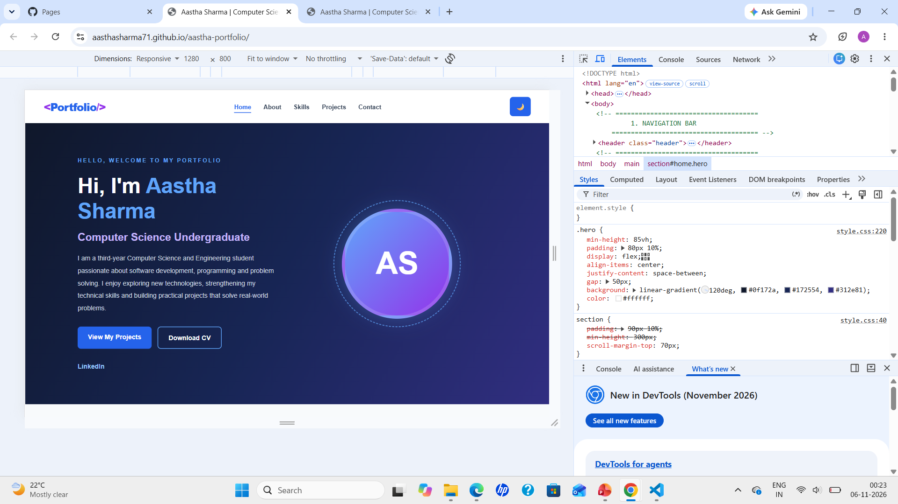
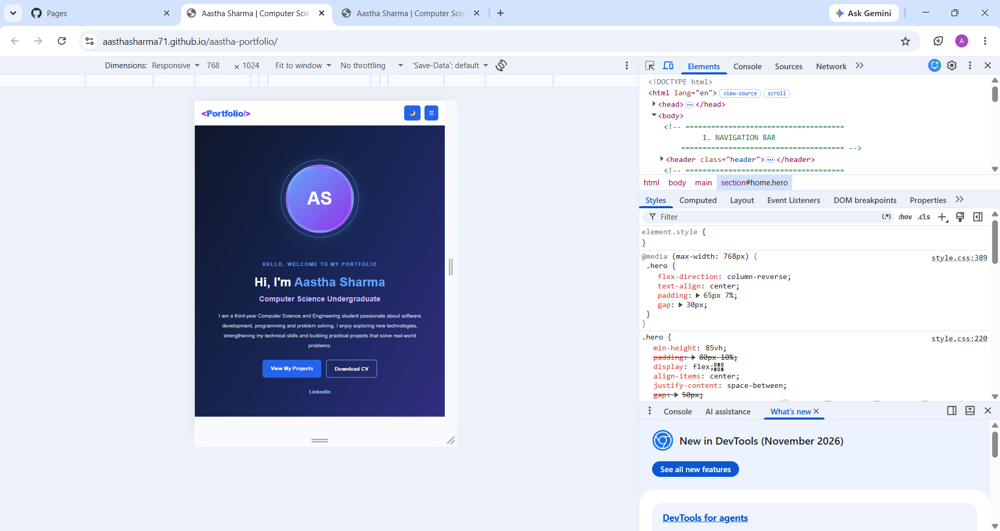
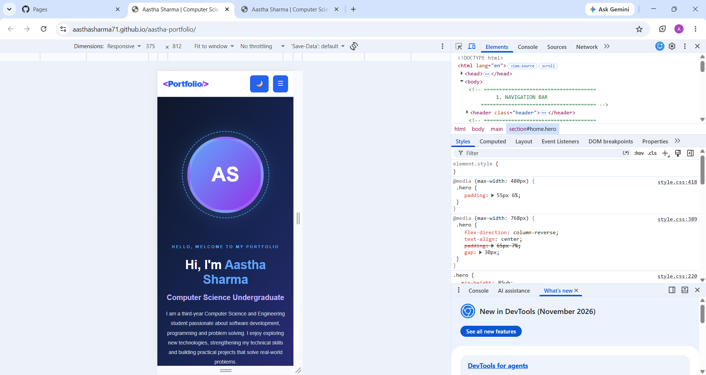

# Aastha Sharma – Personal Portfolio Website

A modern, responsive personal portfolio website showcasing my background, technical skills, projects, certifications, and contact information as a Computer Science and Engineering student and Software Development Enthusiast.
## 📌 About the Project

This portfolio website was developed as part of my CodeNova Frontend Development Internship.

The purpose of this project is to build a professional online presence, showcase my technical knowledge, highlight my projects, and provide an easy way for recruiters and developers to connect with me.

## ✨ Features

- Responsive design for desktop, tablet, and mobile devices.
- Professional introduction and About Me section.
- Technical skills and technologies section.
- Projects showcase, including Smart Campus Attendance via Face and QR-Based Student ID.
- Certifications and achievements section.
- Downloadable CV/Resume.
- Contact section with form validation.
- Dark and light theme support.
- Mobile-friendly navigation menu.
- Back-to-top functionality.
- Clean and user-friendly interface.

## 🛠️ Technologies Used

- **HTML5** – Website structure and semantic elements.
- **CSS3** – Styling, layouts, animations, and responsive design.
- **JavaScript** – Interactive features and dynamic functionality.

## 📁 Project Structure

```text
aastha-portfolio/
│
├── index.html
├── style.css
├── script.js
│
├── assets/
│   └── Aastha_CV.pdf
│
├── screenshots/
│   ├── mobile-375.png
│   ├── tablet-768.png
│   └── desktop-1280.png
│
└── README.md
```

## 📸 Screenshots

### Desktop View


### Tablet View


### Mobile View


## 🚀 How to Run Locally

1. Clone this repository:

   ```bash
   git clone https://github.com/aasthasharma71/aastha-portfolio.git
   ```

2. Open the project folder.

3. Open `index.html` in your browser.

You can also use the VS Code Live Server extension to run the website locally.

## 🧪 Responsive Testing

The portfolio was tested at the following screen sizes:

- Desktop: 1280px
- Tablet: 768px
- Mobile: 375px

Additional checks included navigation functionality, theme switching, CV download, readability, and horizontal overflow.

## 🔮 Future Improvements

- Integrate a backend-powered contact form.
- Add more projects and technical achievements.
- Improve accessibility and user experience.
- Continuously update skills and professional experience.

## 👩‍💻 Author

**Aastha Sharma**

B.Tech Computer Science and Engineering Student  
Software Development Enthusiast

---

⭐ If you find this project interesting, feel free to explore the repository!